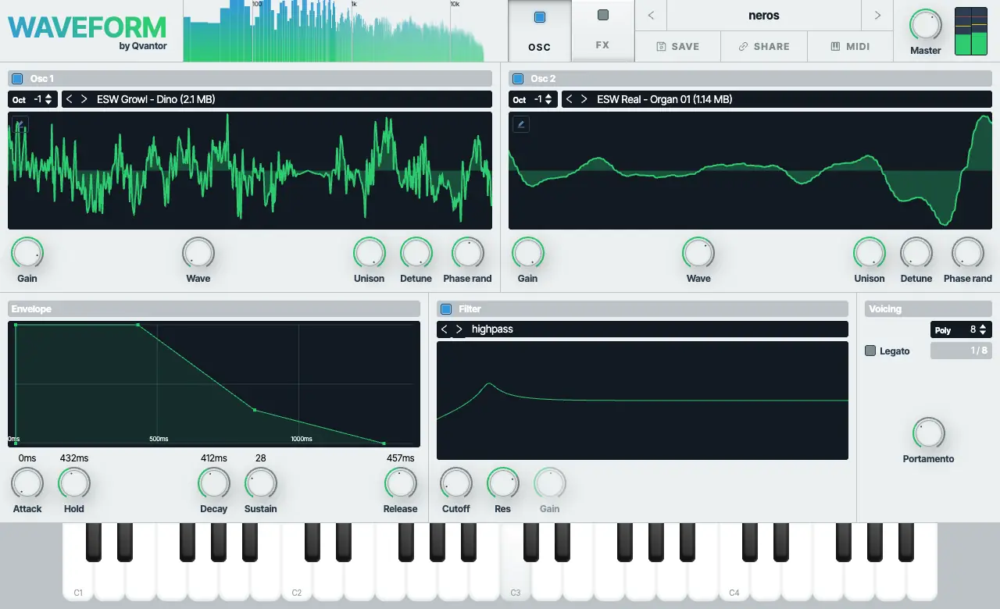
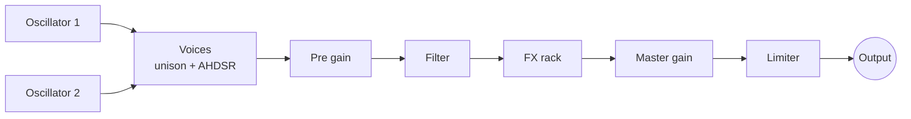

<div align="center">

# Waveform

**Experimental wavetable synth in your browser**

Built with TypeScript, RxJS and the Web Audio API. Nothing to install and no account needed: open it and play.

[](https://github.com/qvantor/waveform/actions/workflows/ci.yml)
[](LICENSE)


[](https://waveformaudio.netlify.app/)

[**▶ Live demo**](https://waveformaudio.netlify.app/) · [Features](#features) · [Getting started](#getting-started) · [Architecture](#architecture) · [Contributing](#contributing)



</div>

## Features

### 🎛 Sound engine

- **Two wavetable oscillators** with frame position, octave shift (±3), unison (1–8 voices), detune, random phase and gain
- **Polyphony** up to 12 voices, with portamento and legato
- **AHDSR envelope**: attack, hold, decay, sustain, release
- **8 filter types**: lowpass, highpass, bandpass, lowshelf, highshelf, peaking, notch and allpass, with a chart of the real frequency response
- **Master section** with the master volume in dB (up to +12 dB of drive), a transparent true peak limiter running in an AudioWorklet (−0.5 dBTP ceiling, 2 ms lookahead, program-dependent release: louder without clipping), a volume meter and a spectrum analyser

### ✨ FX rack

- Effects chain with drag-and-drop ordering, per-effect dry/wet mix and bypass
- **Delay** with normal and ping-pong modes, Haas stereo panning and a bandpass filter in the feedback loop
- Built-in delay presets: Slapback, Stereo widener, Digital echo, Ping-pong 250ms, Echo 375ms, Echo 500ms, Wide ping-pong, Tape echo, Dub, Ambient wash, Lo-fi, Metallic comb
- **Reverb** modelled on FL Studio Fruity Reverb 2: an algorithmic 16-line feedback delay network running in an AudioWorklet, with input low cut, predelay, room size, decay with hi damping and a bass multiplier, tail modulation depth (every line has its own LFO), stereo separation and early reflections level (damped like the tail; the wet level is the common mix), plus a decay-over-frequency display. An **Era** switch colors the input like vintage units: Now (full band), 80s (clean, converter-like bandwidth limit and a little low-mid body) and 70s (darker, with a touch of asymmetric tube saturation)
- Built-in reverb presets: Small room, Medium room, Bright room, Dark chamber, Plate, Vintage plate, Vocal plate, Large hall, Cathedral, Lush modulated, Ambient wash

### 🌊 Wavetables

- Wavetable library, browsable as a folder tree
- **Wavetable editor**: draw your own waves by hand, or build a table from an uploaded audio file

### 💾 Presets

- **Save and share** a sound as a link (`?preset=<id>`)
- **Browse and search** community presets; the **Popular** tab ranks them by how long people actually play them
- Step through presets with ◀ ▶
- **Edit your own presets** later; the edit token stays in your browser
- Duplicate sounds are detected, names are unique, and spam is blocked with Cloudflare Turnstile and rate limits
- Report inappropriate presets

### 🎹 Play anywhere

- On-screen piano, QWERTY keyboard and **Web MIDI** with a device selector
- **Mobile layout** with Synth and Keys modes, multitouch and a two-tier keyboard

### 🔒 Privacy

- No accounts. IP addresses are stored only as salted hashes, for rate limits and to count unique listeners.

## Keyboard shortcuts

| Keys                                  | Action                    |
| ------------------------------------- | ------------------------- |
| `Z` `S` `X` `D` `C` … `M` (`,` … `/`) | Notes from C3 (lower row) |
| `Q` `2` `W` `3` `E` … `U` (`I` … `]`) | Notes from C4 (upper row) |
| `Cmd/Ctrl` + `S`                      | Save preset               |

Notes are ignored while a text field has focus.

## Getting started

### Prerequisites

- Node.js (the version is in [`.nvmrc`](.nvmrc)) and npm
- [mkcert](https://github.com/FiloSottile/mkcert) (`brew install mkcert` on macOS) for the local HTTPS certificate of `netlify dev`
- For wavetables and presets: an S3 bucket with wavetable `.wav` files and a Postgres database (Neon, Supabase or any other)

### Installation

```bash
git clone https://github.com/qvantor/waveform.git
cd waveform
npm ci
cp .env.example .env   # then fill in the values
mkcert -install        # once per machine: trusts the mkcert CA
npm run certs          # certificate for localhost and your LAN IPs in .certs/
```

Apply the database migrations in order:

```bash
for f in db/migrations/*.sql; do psql "$DATABASE_URL" -f "$f"; done
```

### Run

```bash
npm start
```

This starts `netlify dev` (functions on `https://localhost:8888`) and the dev server on [http://localhost:4200](http://localhost:4200). The dev server proxies `/api/*` and `/.netlify/*` to the functions. `netlify dev` doesn't start without the certificate from `npm run certs`; rerun it when your LAN IP changes.

To run only the frontend use `npm run client:start`. Wavetables and presets won't load in that mode.

### Environment variables

| Variable                                       | Description                                                          |
| ---------------------------------------------- | -------------------------------------------------------------------- |
| `BUCKET`, `ACCESS_KEY_ID`, `SECRET_ACCESS_KEY` | S3 bucket with wavetables (region `eu-central-1`)                    |
| `DATABASE_URL`                                 | Postgres connection string (pooled)                                  |
| `NX_TURNSTILE_SITE_KEY`                        | Cloudflare Turnstile site key, inlined into the client at build time |
| `TURNSTILE_SECRET`                             | Cloudflare Turnstile secret, used by functions                       |
| `IP_HASH_SALT`                                 | Random string for hashing IPs (`openssl rand -hex 32`)               |
| `MIN_UNIQUE_USERS`                             | Unique listeners a preset needs before it gets a popularity score    |
| `REPORT_HIDE_THRESHOLD`                        | Number of reports after which a preset is hidden                     |

`.env.example` ships with Cloudflare test keys that always pass, which is handy for local development.

## Scripts

| Command                  | Description                                              |
| ------------------------ | -------------------------------------------------------- |
| `npm start`              | Functions and dev server together                        |
| `npm run client:start`   | Frontend only                                            |
| `npm run certs`          | Local HTTPS certificate for `netlify dev` (needs mkcert) |
| `npm run build`          | Production build to `dist/apps/waveform`                 |
| `npm run test:all`       | All Jest tests (`npx nx test <project>` for one project) |
| `npm run lint`           | ESLint for all projects                                  |
| `npm run typecheck`      | `tsc --noEmit` for every app, lib and the functions      |
| `npm run knip`           | Unused files, exports and dependencies                   |
| `npm run prettier:check` | Formatting check (`prettier:fix` to fix)                 |
| `npm run precheck`       | Everything CI runs                                       |

## Tech stack

- **Frontend**: TypeScript, React 18, RxJS, Web Audio API, Web MIDI API, antd 5, styled-components, react-query, dnd-kit
- **Backend**: Netlify Functions (v2, including scheduled functions), Postgres, AWS S3, zod
- **Tooling**: Nx monorepo, Jest, ESLint, Prettier, knip, GitHub Actions

## Project structure

```
apps/waveform/          React app: synth modules, UI, presets client
libs/
  math/                 number, vector and typed-array helpers, FFT wave utilities
  rxjs-react/           rxModel: RxJS state models bound to React context
  ui-kit/               knobs, charts, piano, analysers, ADSR widget, theme
  preset-schema/        zod schema of presets, normalization, hashing (shared by client and server)
netlify/
  functions/            presets API, usage stats, wavetables, scheduled jobs
  tests/                function specs
db/migrations/          Postgres schema
scripts/                maintenance scripts (rate limit checks, local certificates)
```

## Architecture

All state and audio logic live in RxJS **models** (`rxModel` from `libs/rxjs-react`), not in React state. A model holds BehaviorSubjects and Web Audio nodes, exposes actions and wires state to audio in subscriptions. React components only subscribe to it. Models depend on each other through nested providers.

The audio graph:



Note input from the on-screen piano, QWERTY and MIDI goes through one shared input controller. Synth state is serialized into presets through a snapshot plugin and validated by the shared zod schema.

See [CLAUDE.md](CLAUDE.md) for a detailed walkthrough of the models, the audio graph, snapshots and the presets API.

## Contributing

Contributions are welcome! To get started:

1. Fork the repo and create a branch from `main`.
2. Make your changes. New features need tests (see the existing `*.spec.ts` files).
3. Run `npm run precheck`: formatting, types, lint, knip and tests must pass, the same checks CI runs on every PR.
4. Open a pull request.

Found a bug or have an idea? [Open an issue](https://github.com/qvantor/waveform/issues).

## License

Distributed under the Apache License 2.0. See [LICENSE](LICENSE).
