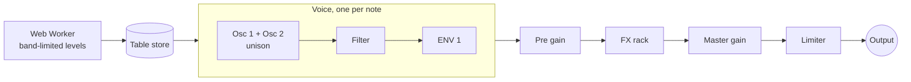

<div align="center">

# Waveform

**Experimental wavetable synth in your browser**

Built with TypeScript, Rust (WebAssembly), RxJS and the Web Audio API. Nothing to install and no account needed: open it and play.

[](https://github.com/qvantor/waveform/actions/workflows/ci.yml)
[](LICENSE)


[](https://waveform.qvantor.org/)

[**▶ Live demo**](https://waveform.qvantor.org/) · [Features](#features) · [Getting started](#getting-started) · [Architecture](#architecture) · [Contributing](#contributing)


</div>

## Features

### 🎛 Sound engine

- **Two wavetable oscillators** with frame position, octave shift (±3), unison (1–8 voices), detune, start phase, random phase and gain. They run in an AudioWorklet on a Rust core and are band-limited, with as little aliasing on high notes as Chrome's native oscillator. Wave, Phase, Phase rand and Unison sit in a strip under the wave chart: drag them
- Tables with a morph mark play as 256 frames crossfaded between their waves
- **Polyphony** up to 12 voices, with portamento and legato; at Poly 1 it plays **mono**: a new note takes the voice over, and releasing it goes back to the key still held. A stolen voice fades out in 20 ms, the quietest released one first
- **Three envelopes** (ENV 1–3: attack, hold, decay, sustain, release, up to 32 s each). ENV 1 is the volume. Drag the point in the middle of a stage to bend its curve, double click it to reset
- **Modulation**: drag an ENV tab onto a knob to route it there. It works on oscillator gain, wave and detune, filter cutoff, resonance and gain, and every FX knob and mix. While notes play, the knobs, the wave, the filter response and the FX charts show where the envelopes move them
- **8 filter types** in every voice: lowpass, highpass, bandpass, lowshelf, highshelf, peaking, notch and allpass, with a chart of the real frequency response
- **Master section** with the master volume in dB (up to +12 dB of drive), a transparent true peak limiter (−0.5 dBTP ceiling, 2 ms lookahead, program-dependent release: louder without clipping), a volume meter and a spectrum analyser
- **Clean preset switching**: the sound fades out in 20 ms, effect tails are cleared, and the next preset starts once its wavetables are ready, with the keys still held
- **Latency setting** (desktop Chromium): Auto (the default) plays at low latency and switches to Normal on this computer if the sound crackles; Low and Normal can be chosen by hand

### ✨ FX rack

- Effects chain with drag-and-drop ordering, per-effect dry/wet mix and bypass
- **Distortion**: a waveshaper with Soft clip (tanh, 4× oversampled) and Hard clip (8× oversampled) modes, linear phase filters (no inharmonic aliases on high notes; the dry signal is delayed as much, so the mix stays clean), drive up to 12 dB with an automatic makeup gain (a note keeps its loudness at any drive, the curve only changes its color), a tone lowpass after the curve, an output level trim and a transfer curve display
- Built-in distortion presets: Warm, Overdrive, Crunch, Fuzz, Parallel grit, Lo-fi
- **Delay** with normal and ping-pong modes, Haas stereo panning and a bandpass filter in the feedback loop
- Built-in delay presets: Slapback, Stereo widener, Digital echo, Ping-pong 250ms, Echo 375ms, Echo 500ms, Wide ping-pong, Tape echo, Dub, Ambient wash, Lo-fi, Metallic comb
- **Reverb**: an algorithmic 16-line feedback delay network with input low cut, predelay, room size, decay with hi damping and a bass multiplier, tail modulation depth (every line has its own LFO), stereo separation and early reflections level (damped like the tail; the wet level is the common mix), plus a decay-over-frequency display. An **Era** switch colors the input like vintage units: Now (full band), 80s (clean, converter-like bandwidth limit and a little low-mid body) and 70s (darker, with a touch of asymmetric tube saturation)
- Built-in reverb presets: Small room, Medium room, Bright room, Dark chamber, Plate, Vintage plate, Vocal plate, Large hall, Cathedral, Lush modulated, Ambient wash
- Distortion, reverb and the limiter run in AudioWorklets on Rust cores; the envelopes of the last note move the FX knobs too

### 🌊 Wavetables

- Wavetable library, browsable as a folder tree, arrows step through the tables
- **Wavetable editor**: draw your own waves by hand, or build a table from an uploaded audio file

### 💾 Presets

- **Save and share** a sound as a link (`?preset=<id>`)
- **Browse and search** community presets; the **Popular** tab ranks them by the share of people who keep playing them for a minute instead of skipping on. A fresh visit opens a random popular one
- Step through presets with ◀ ▶, back to an empty patch with Init
- **Edit your own presets** later; the edit token stays in your browser
- The tab keeps an unsaved sound when you reload the page
- Duplicate sounds are detected, names are unique, and spam is blocked with Cloudflare Turnstile and rate limits; listens behind Popular pass an invisible Turnstile check too
- Report inappropriate presets

### 🎹 Play anywhere

- On-screen piano, QWERTY keyboard and **Web MIDI** with input and channel selection
- **Mobile layout** with Synth and Keys modes, multitouch and a two-tier keyboard

### 🔒 Privacy

- No accounts. IP addresses are stored only as salted hashes, for rate limits and to count unique listeners.

## Browser support

Current Chrome, Edge, Safari and Firefox, on desktop and mobile. The synth needs AudioWorklet and WebAssembly SIMD (Safari 16.4 or newer), and AudioWorklet needs a secure context: HTTPS or `localhost`.

## Keyboard shortcuts

| Keys                                  | Action                    |
| ------------------------------------- | ------------------------- |
| `Z` `S` `X` `D` `C` … `M` (`,` … `/`) | Notes from C3 (lower row) |
| `Q` `2` `W` `3` `E` … `U` (`I` … `]`) | Notes from C4 (upper row) |
| `Cmd/Ctrl` + `S`                      | Save preset               |

Notes are ignored while a text field has focus.

## Getting started

### Prerequisites

- Node.js (the version is in [`.nvmrc`](.nvmrc)) and npm
- [rustup](https://rustup.rs/): the first build installs the Rust toolchain pinned in [`dsp/rust-toolchain.toml`](dsp/rust-toolchain.toml) with its `wasm32-unknown-unknown` target (`wasm-opt` comes with npm)
- [mkcert](https://github.com/FiloSottile/mkcert) (`brew install mkcert` on macOS) for the local HTTPS certificate of `netlify dev`
- For wavetables and presets: an S3 bucket with wavetable `.wav` files and a Postgres database (Neon, Supabase or any other)

### Installation

```bash
git clone https://github.com/qvantor/waveform.git
cd waveform
npm ci
cp .env.example .env   # then fill in the values
mkcert -install        # once per machine: trusts the mkcert CA
npm run certs          # certificate for localhost and your LAN IPs in .certs/
```

Apply the database migrations in order:

```bash
for f in db/migrations/*.sql; do psql "$DATABASE_URL" -f "$f"; done
```

### Run

```bash
npm start
```

This builds the Rust cores and the worklet bundles (and rebuilds them on every change), then starts `netlify dev` (functions on `https://localhost:8888`) and the dev server on [http://localhost:4200](http://localhost:4200). The dev server proxies `/api/*` and `/.netlify/*` to the functions. `netlify dev` doesn't start without the certificate from `npm run certs`; rerun it when your LAN IP changes.

To run only the frontend use `npm run client:start`. Wavetables and presets won't load in that mode.

### Environment variables

| Variable                                       | Description                                                          |
| ---------------------------------------------- | -------------------------------------------------------------------- |
| `BUCKET`, `ACCESS_KEY_ID`, `SECRET_ACCESS_KEY` | S3 bucket with wavetables (region `eu-central-1`)                    |
| `DATABASE_URL`                                 | Postgres connection string (pooled)                                  |
| `NX_TURNSTILE_SITE_KEY`                        | Cloudflare Turnstile site key, inlined into the client at build time |
| `TURNSTILE_SECRET`                             | Cloudflare Turnstile secret, used by functions                       |
| `IP_HASH_SALT`                                 | Random string for hashing IPs (`openssl rand -hex 32`)               |
| `MIN_UNIQUE_USERS`                             | Listeners who stayed a preset needs before it gets a score           |
| `POPULAR_MIN_USERS`                            | Listeners who stayed a preset needs to be in Popular                 |
| `SCORE_PRIOR_LISTENERS`                        | Listeners of the average share added to every preset's score         |
| `REPORT_HIDE_THRESHOLD`                        | Reports (from different IPs, last 180 days) that hide a preset       |

`.env.example` ships with Cloudflare test keys that always pass, which is handy for local development.

## Scripts

| Command                  | Description                                                                 |
| ------------------------ | --------------------------------------------------------------------------- |
| `npm start`              | Functions and dev server together                                           |
| `npm run client:start`   | Frontend only                                                               |
| `npm run certs`          | Local HTTPS certificate for `netlify dev` (needs mkcert)                    |
| `npm run build`          | Production build to `dist/apps/waveform`                                    |
| `npm run wasm`           | Rust cores of the worklets to WebAssembly (`tmp/wasm`, `tmp/wasm-perf`)     |
| `npm run worklets`       | AudioWorklet and Web Worker bundles with esbuild (`tmp/worklets`)           |
| `npm run test:all`       | All Jest tests (`npx nx test <project>` for one project)                    |
| `npm run dsp:check`      | `cargo fmt`, `clippy`, `cargo test` and the size budgets of the Rust cores  |
| `npm run lint`           | ESLint for all projects                                                     |
| `npm run typecheck`      | `tsc --noEmit` for every app, lib and the functions                         |
| `npm run knip`           | Unused files, exports and dependencies                                      |
| `npm run prettier:check` | Formatting check (`prettier:fix` to fix)                                    |
| `npm run precheck`       | Everything CI runs                                                          |
| `npm run build:perf`     | Production build with a test hook for the perf suite (`scripts/bench-perf`) |

## Tech stack

- **Frontend**: TypeScript, React 18, RxJS, Web Audio API (AudioWorklet), Web Workers, Web MIDI API, antd 5, styled-components, react-query, dnd-kit
- **DSP**: Rust compiled to WebAssembly with SIMD (`no_std`, no wasm-bindgen), binaryen `wasm-opt`
- **Backend**: Netlify Functions (v2, including scheduled functions), Postgres, AWS S3, zod
- **Tooling**: Nx monorepo, Jest, ESLint, Prettier, knip, cargo clippy and fmt, Playwright benchmarks, GitHub Actions

## Project structure

```
apps/waveform/          React app: synth modules, worklets, UI, presets client
libs/
  math/                 number, vector and typed-array helpers, FFT wave utilities, biquad coefficients
  rxjs-react/           rxModel: RxJS state models bound to React context
  ui-kit/               knobs, charts, piano, analysers, ADSR widget, theme
  preset-schema/        zod schema of presets, normalization, hashing (shared by client and server)
dsp/                    Rust cores of the worklets: wavetable-osc, limiter, reverb, distortion,
                        dsp-core (shared blocks), jsmath (JS Math bit for bit); golden hashes of their sound
netlify/
  functions/            presets API, usage stats, wavetables, scheduled jobs
  tests/                function specs
db/migrations/          Postgres schema
scripts/                wasm build, perf suite and benchmarks (bench-perf, bench-osc), browser checks
                        of the wasm cores, rate limit checks, local certificates
```

## Architecture

All state and audio logic live in RxJS **models** (`rxModel` from `libs/rxjs-react`), not in React state. A model holds BehaviorSubjects and Web Audio nodes, exposes actions and wires state to audio in subscriptions. React components only subscribe to it. Models depend on each other through nested providers.

The audio graph:



Every note is one AudioWorkletNode: both oscillators with their unison voices, the filter, the envelopes and the modulation run in its processor. A Web Worker builds the band-limited levels of each wavetable and streams them to a table store on the audio thread, which all voices share. The processors of the oscillator, the distortion, the reverb and the limiter run Rust cores compiled to WebAssembly (`dsp/`); the delay is built from native nodes. The cores were ported from TypeScript bit for bit, and golden hashes of their output (`dsp/goldens/`) keep the sound from changing by accident.

Note input from the on-screen piano, QWERTY and MIDI goes through one shared input controller. Synth state is serialized into presets through a snapshot plugin and validated by the shared zod schema.

See [CLAUDE.md](CLAUDE.md) for a detailed walkthrough of the models, the audio graph, the Rust cores, snapshots and the presets API.

## Contributing

Contributions are welcome! To get started:

1. Fork the repo and create a branch from `main`.
2. Make your changes. New features need tests (see the existing `*.spec.ts` files; Rust has its own `cargo test`).
3. Run `npm run precheck`: formatting, types, lint, knip, the Rust checks and tests must pass, the same checks CI runs on every PR. A change of the sound of a Rust core needs its golden hashes recorded again (`UPDATE_GOLDENS=1`, see [CLAUDE.md](CLAUDE.md)).
4. Open a pull request.

Found a bug or have an idea? [Open an issue](https://github.com/qvantor/waveform/issues).

## License

Source-available under the [PolyForm Noncommercial License 1.0.0](LICENSE): use, change and share it for any noncommercial purpose (personal use, hobby projects, research, education, nonprofit organizations). Commercial use needs a separate license: [contact the author](https://github.com/qvantor).

Earlier versions were released under the Apache License 2.0 and stay under it. Third-party code and its licenses are listed in [NOTICE](NOTICE).
